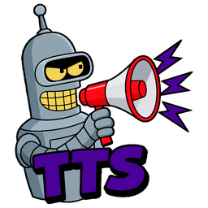
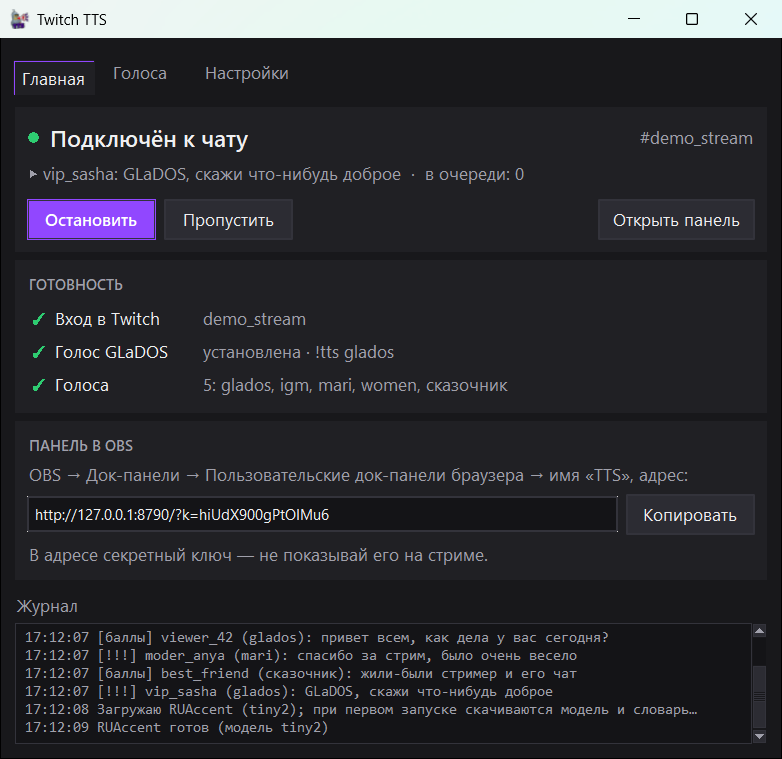
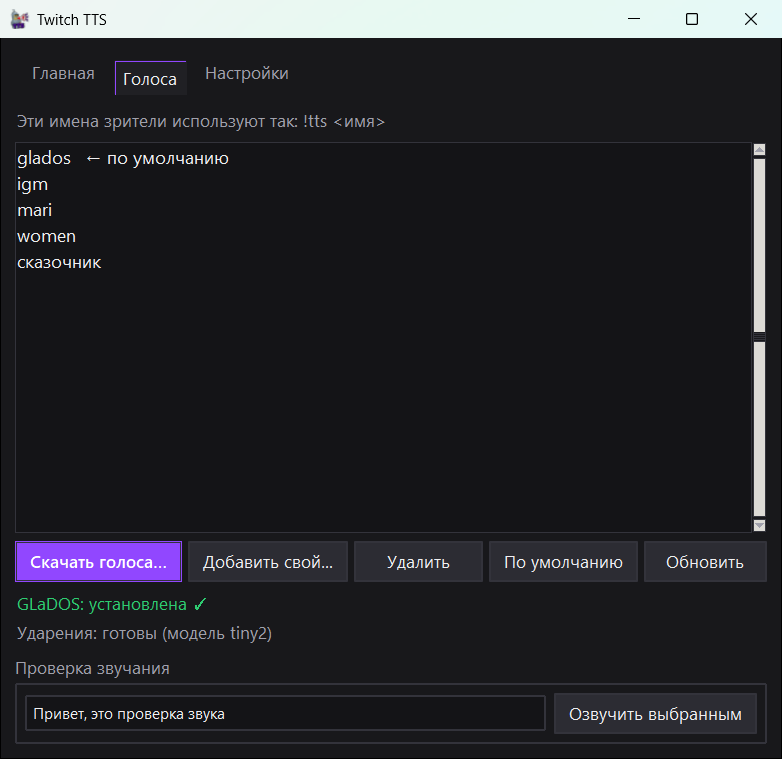
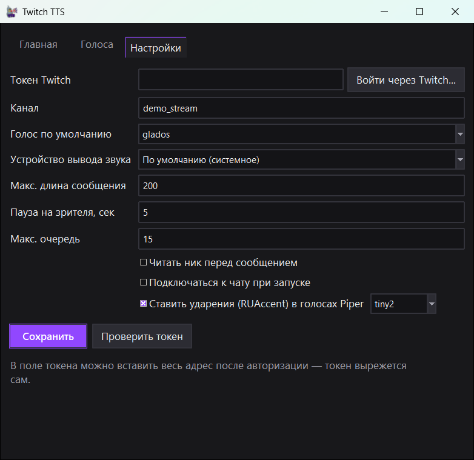
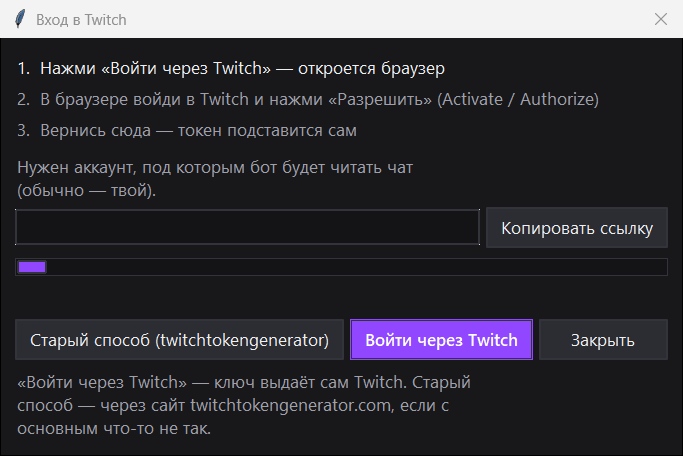
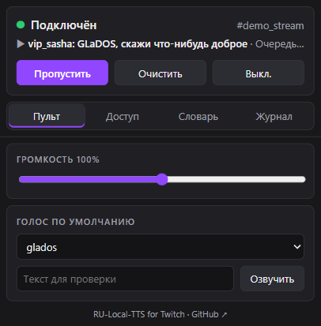
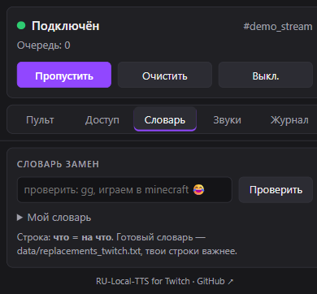
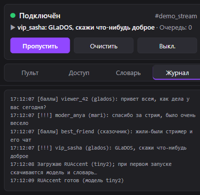
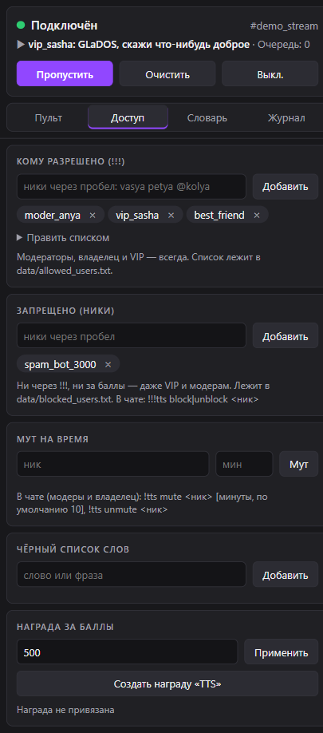
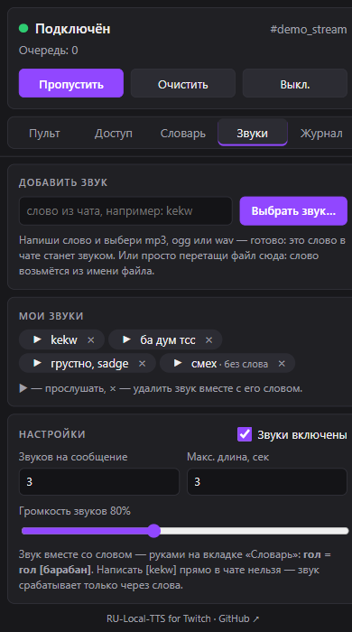

# RU Local TTS for Twitch

**Озвучка чата Twitch на русском: голос GLaDOS, голоса Piper, ударения и панель-док для OBS**

Работает локально на процессоре, видеокарта не нужна. Всё хранится в одной папке: удалил папку — программы нет.

   

**[Скачать](../../releases/latest)** · [Установка](#установка) · [Команды](#команды-в-чате) · [Панель OBS](#панель-в-obs) · [Вопросы](#частые-вопросы) · [Issues](../../issues)

## Возможности

- **Голоса:** русская GLaDOS (движок TeraTTS) и Piper — IGM, Mari, Women, Сказочник. Можно добавить свой `.onnx`
- **Ударения** ставятся сами (RUAccent), спорные слова можно поправить в своём словаре
- **Кто озвучивает:** зрители — наградой за баллы канала, модеры, VIP и избранные — сообщением `!!!текст`
- **Звуки вместо слов:** написали слово, выбрали mp3 — и это слово в чате играет вашим звуком
- **Панель-док для OBS:** пропуск, громкость, голос, доступ, чёрный список, словарь замен, звуки, журнал
- **Порядок в чате:** чёрный список слов, запрет ников, муты на время, защита от спама и повторов
- **Лёгкая:** около 20% процессора и 1 ГБ памяти под нагрузкой, уступает процессор игре и OBS
- **Вход в Twitch в два клика** — без ручного копирования токенов
- **Автообновление без потери настроек** — программа сама проверяет новую версию на GitHub и обновляется по вашему согласию

<table>
  <tr>
    <td width="50%" valign="top"></td>
    <td width="50%" valign="top"></td>
  </tr>
  <tr>
    <td align="center">Голоса: скачать, добавить свой, проверить звучание</td>
    <td align="center">Настройки: канал, голос, звук, ограничения</td>
  </tr>
</table>

## Установка

> [!IMPORTANT]
> Нужны Windows 10 или 11, интернет и около 1,5 ГБ места. Установка занимает 5–10 минут.
> Установщик скачивает Python, пакеты и голоса с `github.com`, `pypi.org` и `huggingface.co` и кладёт всё в папки
> `tools\` и `venv\` рядом с программой — в систему ничего не ставится. Скачивайте программу только с этой страницы.

1. Откройте **[последний релиз](../../releases/latest)** и в разделе **Assets** скачайте архив `.zip`.
2. Правый клик по архиву → «Свойства» → галочка **«Разблокировать»** → «ОК». С 7-Zip или PeaZip этот шаг можно пропустить.
3. Распакуйте архив в любую папку, например в «Документы». Запускать прямо из архива нельзя.
4. Запустите **`start_tts.bat`**. Откроется установщик: 6 шагов с полоской и оставшимся временем, трогать ничего не нужно.
   - На шаге 4 появится окно «Голоса для TTS»: отметьте нужные и нажмите «Скачать».
     GLaDOS ~210 МБ, остальные ~61 МБ каждый, плюс ~355 МБ модели ударений при первой установке.
   - Не скачанные голоса можно докачать потом: «Голоса» → «Скачать голоса…».
5. Войдите в Twitch: «Войти через Twitch» → в браузере нажмите **«Activate» / «Разрешить»**.
   Входить нужно в аккаунт того канала, чей чат будет озвучиваться.
6. На вкладке «Главная» нажмите **«Подключиться»** — должно загореться зелёным «Подключён к чату».
7. Звук в OBS: источник **«Захват звука приложения»** → `pythonw.exe` (или своё устройство вывода в «Настройках»).

Дальше программа запускается ярлыком «TwitchTTS» на рабочем столе.
Пошаговая инструкция для новичка — в файле [**`КАК УСТАНОВИТЬ.txt`**](./КАК%20УСТАНОВИТЬ.txt).

<b>Так выглядит окно входа в Twitch</b>

 

> [!WARNING]
> **Антивирус** может спросить разрешение при первом запуске `start_tts.bat` — установщик скачивает файлы из интернета.
> Если Windows показала синее окно «Windows защитила ваш компьютер» — «Подробнее» → «Выполнить в любом случае».

## Обновление

**Автоматически.** При запуске программа проверяет страницу проекта на GitHub. Если вышла новая версия, появится окно
«Вышла новая версия приложения» с кнопками «Обновить сейчас», «Позже» и «Пропустить эту версию». После «Обновить сейчас»
программа закроется, отдельный скрипт `self_update.ps1` скачает и установит новую версию и запустит её снова.
Проверку можно выключить или запустить вручную: «Настройки» → «Автоматически проверять обновления» / «Проверить сейчас».

Скрипт не трогает `config.json` (вход в Twitch и настройки), `data\` (ваши словари, списки, муты), голоса и `venv\`.
Старый код сохраняется в `_backup\обновление_<дата>`; если обновление оборвалось, файлы возвращаются сами. Ход обновления пишется в `data\update.log`.

**Вручную** (если автообновление не сработало или в вашей версии его ещё нет):

1. Скачайте новый архив со страницы **[Releases](../../releases/latest)** в «Загрузки» или на рабочий стол (распаковывать не нужно).
2. Запустите **`ОБНОВИТЬ.bat`** в папке программы — он сам найдёт архив и спросит, обновить ли из него.

Меняется только код: старый сохраняется в `_backup\обновление_<дата>`, а `config.json`, `data\`, голоса и `venv\` не трогаются —
вход в Twitch, словари, списки и муты остаются.
Если в вашей версии ещё нет `ОБНОВИТЬ.bat` — запустите его из распакованного нового архива и укажите папку программы.
Чтобы автообновление видело релиз, версия в `version.txt` и тег релиза на GitHub должны совпадать (например, `b1.3`).
Список изменений — в [`ЧТО НОВОГО.txt`](./ЧТО%20НОВОГО.txt).

## Команды в чате

**Кто озвучивает**
- Зрители — наградой за баллы канала. Награду создаёт сам бот: панель → «Доступ» → «Создать награду» или `!!!tts reward create 500`
- Модеры, владелец, VIP и список разрешённых — сообщением `!!!текст`

| Команда | Кто | Что делает |
|---|---|---|
| `!tts` / `!tts <голос>` | все | список голосов / выбрать свой |
| `!skip` | модеры | пропустить текущую озвучку |
| `!!!tts add\|del <ник…>`, `set <ник…>`, `list` | модеры | кому можно `!!!` |
| `!!!tts ban\|unban <слово>` | модеры | чёрный список слов |
| `!!!tts block <ник>`, `unblock <ник>` | модеры | запретить TTS насовсем, даже VIP и модерам |
| `!tts mute <ник> [мин]`, `!tts unmute <ник>` | модеры | запретить TTS на время (по умолчанию 10 мин) |
| `!!!tts reward create [цена]`, `price <N>` | владелец | награда и её цена |
| `!!!tts reload` | модеры | перечитать голоса, списки, словарь |

В тексте награды: `!tts mari привет` — сменить голос и озвучить, `!tts mari` — только сменить.
Сообщения, удалённые модером, бан и очистка чата обрывают озвучку.
Запрещённым и замученным бот не озвучивает ни `!!!`, ни баллы (баллы спишутся — вернуть вручную в очереди наград).
Одинаковое сообщение за 30 секунд читается один раз, а «лол лол лол лол лол» сокращается до трёх повторов.

## Панель в OBS

1. В программе: «Главная» → **«Копировать»**.
2. В OBS: «Док-панели» → «Пользовательские док-панели браузера…» → имя `TTS`, адрес — скопированная ссылка → «Применить».

<table>
  <tr>
    <td valign="top"></td>
    <td valign="top"></td>
    <td valign="top"></td>
  </tr>
  <tr>
    <td align="center"><b>Пульт</b>: пропуск, громкость, голос, проверка</td>
    <td align="center"><b>Словарь</b>: замены слов и звуки</td>
    <td align="center"><b>Журнал</b>: что и кто озвучивал</td>
  </tr>
</table>

<b>Вкладка «Доступ»</b>: разрешённые, запрещённые ники, муты, чёрный список, награда

 

<b>Вкладка «Звуки»</b>: слово из чата → ваш звук, список звуков, настройки

 

> [!CAUTION]
> В адресе панели секретный ключ. **Не показывайте его на стриме.**

## Настройка

**Голоса**
- Свой голос Piper: «Голоса» → «Добавить свой…» (`.onnx` + `.onnx.json`)
- Ударения ставятся сами; свои — `з+амок` прямо в тексте или в `data\stress_dict.txt` (`слово=сл+ово`, для GLaDOS)
- Звучание «р» у GLaDOS: запустите `test_glados.bat`; если вариант `double` нравится больше — `"tera_r_fix": "double"` в `config.json`

**Тексты**
- **Словарь замен** (`minecraft = майнкрафт`, `gg = гэгэ`): готовый `data\replacements_twitch.txt`, свой — `data\replacements.txt`
  или панель → «Словарь». Слова заменяются целиком, неизвестные эмодзи убираются
- **Звуки вместо слов:** панель → вкладка «Звуки»: напишите слово (`kekw`) и нажмите «Выбрать звук…»
  (mp3, ogg или wav) — или просто перетащите файл на карточку, слово возьмётся из имени файла. Строка `kekw = [kekw]`
  в словарь допишется сама, громкость выровняется сама. Звук вместе со словом — руками в словаре: `гол = гол [барабан]`.
  Там же в «Настройках»: сколько звуков на сообщение (по умолчанию 3), максимальная длина (3 сек) и громкость.
  Звуки лежат в `data\sounds\`; написать `[kekw]` в чате нельзя — звук срабатывает только через словарь
- **Чёрный список:** `data\blacklist.txt` (свой), `data\blacklist_twitch.txt` (готовый). Слова от 4 букв ловятся и внутри слова,
  и написанные врозь, короткие — только целиком; фразы — целиком

<b>Полезные ключи <code>config.json</code></b>

 

| Ключ | Что делает |
|---|---|
| `max_chars`, `user_cooldown_sec`, `max_queue` | длина сообщения, пауза между сообщениями одного зрителя, размер очереди |
| `say_name` | читать ник автора |
| `volume`, `audio_device` | громкость и устройство вывода |
| `replace_on`, `replace_strip_emoji` | словарь замен и удаление неизвестных эмодзи |
| `sounds_on`, `sound_max_per_msg`, `sound_max_sec`, `sound_volume` | звуки вместо слов (то же есть в панели) |
| `accent_on`, `accent_model`, `accent_light` | ударения; `accent_light` — ~1 ГБ памяти вместо ~4 ГБ |
| `tera_unload_min` | выгружать GLaDOS после N минут простоя (0 — держать) |
| `tera_preload`, `glados_autoinstall` | предзагрузка и автоустановка GLaDOS |
| `cpu_threads` | ядер на нейросеть: 3 по умолчанию (~20% CPU), 2 — ещё легче, 0 — все ядра. Проще выбрать пресет: «Настройки» → «Нагрузка на ПК» |
| `low_priority` | `true` — игра и OBS получают процессор первыми (тоже входит в пресет нагрузки) |
| `auto_update` | `true` — проверять обновления при запуске; `skipped_version` — версия, которую вы пропустили |
| `dup_window_sec` | одинаковое сообщение за N секунд читается один раз (30; 0 — выключить) |
| `voice_cache` | сколько голосов Piper держать в памяти (4) |

После правки перезапустите программу. В `config.json` хранится ключ входа в Twitch — никому его не отправляйте.

<b>Что за файлы в папке</b>

 

| Файл | Зачем |
|---|---|
| [`start_tts.bat`](./start_tts.bat) | запуск программы; при первом запуске открывает установщик [`install.ps1`](./install.ps1) |
| [`ОБНОВИТЬ.bat`](./ОБНОВИТЬ.bat) | ручное обновление из скачанного архива (см. [Обновление](#обновление)) |
| [`self_update.ps1`](./self_update.ps1), [`updater.py`](./updater.py) | автообновление: проверка версии на GitHub и скрипт установки |
| [`test_glados.bat`](./test_glados.bat) | проверка звучания GLaDOS |
| [`config.example.json`](./config.example.json) | пример настроек; рабочий `config.json` программа создаёт сама |
| [`data\`](./data) | готовые списки: словарь замен, чёрный список, ударения для GLaDOS |
| [`КАК УСТАНОВИТЬ.txt`](./КАК%20УСТАНОВИТЬ.txt) | инструкция для новичка |
| [`ЧТО НОВОГО.txt`](./ЧТО%20НОВОГО.txt) | список изменений |

## Частые вопросы

<b>Установка оборвалась</b>

Запустите `start_tts.bat` ещё раз — уже скачанное пропускается. Журнал установки — `data\install.log`.

<b>Нет звука</b>

«Настройки» → «Устройство вывода звука», проверьте громкость в панели.
В OBS: «Захват звука приложения» → `pythonw.exe` (программа должна быть запущена).

<b>«Twitch отклонил токен»</b>

«Настройки» → «Войти через Twitch…» и войдите ещё раз. Запасной способ — кнопка «Старый способ (twitchtokengenerator)»
или свой токен вручную.

<b>Нет голоса GLaDOS</b>

«Голоса» → «Скачать голоса…».

<b>GLaDOS говорит медленно или игра подлагивает</b>

Время каждой фразы записывается в `data\tera_worker.log`. На слабом компьютере поставьте `"cpu_threads": 2` в `config.json`.

<b>Программа ест около 3 ГБ памяти</b>

У вас версия до 22.10.2026 — обновитесь через `ОБНОВИТЬ.bat`. Новая версия под нагрузкой занимает около 1 ГБ.

<b>Как удалить</b>

Удалите папку программы и ярлык с рабочего стола. В систему ничего не устанавливается.

Не нашли ответ — напишите во вкладку [**Issues**](../../issues): опишите, что произошло, и приложите `data\install.log`
или скриншот вкладки «Главная» (только не `config.json`). Там же можно предлагать идеи.

## Голос GLaDOS

Это фанатская модель ([`TeraTTS/glados2-g2p-vits`](https://huggingface.co/TeraTTS/glados2-g2p-vits), проект
[KPEKEP/GLaDOS](https://github.com/KPEKEP/GLaDOS)). У модели нет лицензии, а оригинальный голос принадлежит Valve —
**используйте его только для своих стримов**, не продавайте. Голоса в репозитории не хранятся, они скачиваются при установке.

## Откуда что

- Вход в Twitch — напрямую у Twitch (Device Code Flow, публичный `CLIENT_ID` в `twitch_auth.py`);
  запасной способ — [twitchtokengenerator.com](https://twitchtokengenerator.com/). Ключ обновляется сам
- Голоса Piper — [`rraaww/ru_piper`](https://huggingface.co/rraaww/ru_piper) ([piperhub.org](https://piperhub.org)),
  движок [Piper](https://github.com/OHF-Voice/piper1-gpl)
- GLaDOS — [`TeraTTS`](https://huggingface.co/TeraTTS/glados2-g2p-vits), проект [KPEKEP/GLaDOS](https://github.com/KPEKEP/GLaDOS)
- Ударения — [RUAccent](https://github.com/Den4ikAI/ruaccent)

Программа создана с помощью нейросети (Claude от Anthropic) и проверена на реальных стримах с запущенными играми.

## Участники

- [Koty9n](https://github.com/Koty9n) — автор проекта
- [VasiliskBRO](https://github.com/VasiliskBRO) — со-автор проекта
- [OldForever](https://github.com/oldforever) — участник проекта

## Лицензия

Код распространяется по лицензии [GNU GPL v3.0](./LICENSE): он использует `piper-tts` (GPL-3.0), поэтому и проект открыт
на тех же условиях. Лицензия не распространяется на сторонние голоса и модели — у них свои условия (см. выше).
